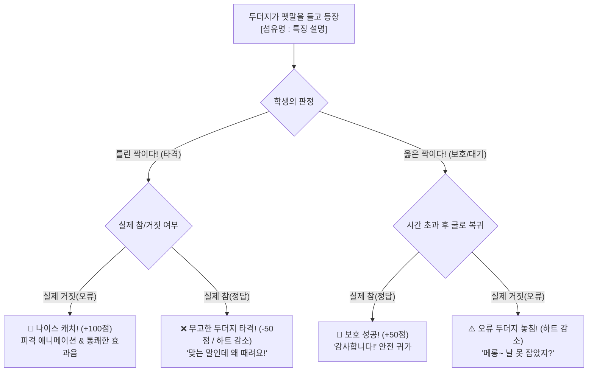

# 🎮 [수업용 게임] 섬유 팩트체크 두더지 잡기 게임 구현 계획서

> **"옳은 짝은 지켜주고(Pass), 틀린 짝만 뿅망치로 잡는다(Smash)!"**  
> 중학교 기술·가정(의생활 단원) 수업용 역발상 에듀테크 미니게임 개발 계획입니다.

---

## 1. 프로젝트 개요 & 교육적 목표

### 1.1 기획 의도 및 페르소나
- **개발자 페르소나**: 중학교 기술·가정 교사 개발자
- **수업 대상**: 중학교 1~3학년 학생 (교실 전자칠판, 1인 1태블릿/크롬북 환경)
- **교과 단원**: 기술·가정 <옷차림과 자기표현> / <의복의 마련과 관리> - **섬유의 종류와 특징**
- **기존 두더지 게임과의 차별점 (역발상 메커니즘)**:
  - 보통 두더지 게임은 "정답"을 치는 방식이지만, 본 게임은 **"옳은 설명은 보호하고, 틀린 설명(오류 두더지)만 잡는"** 규칙입니다.
  - 이를 통해 학생들이 설명을 대충 훑어보고 클릭하는 단순 반사행동을 방지하고, **문장을 끝까지 읽고 참/거짓을 비판적으로 판단하는 인지적 사고력**을 유도합니다.

---

## 2. 게임 룰 & 코어 메커니즘



### 2.1 상세 규칙
1. **화면 구성**: 3×3(총 9개) 또는 2×3(스마트폰/태블릿 최적화 6개) 두더지 굴
2. **두더지 출현**:
   - 두더지가 머리 위 팻말(또는 말풍선)에 `[섬유 이름 : 특징 설명]`을 들고 올라옵니다.
   - 예시:
     - ⭕ **바른 두더지**: `면(식물성) : 흡습성이 좋고 열에 강해 삶아 빨 수 있다.`
     - ❌ **틀린 두더지**: `모/양모(동물성) : 물에 젖으면 강도가 세지고 열에 매우 강하다.` (→ 면의 특징을 섞은 오류)
3. **행동 및 판정**:
   - **틀린 두더지 클릭/터치**: 뿅망치 타격! 정답 판정 (`+100점`, 콤보 증가)
   - **옳은 두더지 방치**: 2.5초~3.5초 후 안전하게 굴로 쏙 들어감 (`+50점`, 방어 성공)
   - **실수 1 (옳은 두더지를 때림)**: 하트 1개 감소 (`-50점`, 억울해하는 두더지 표정)
   - **실수 2 (틀린 두더지를 방치함)**: 하트 1개 감소 (도망치며 약 올리는 표정)
4. **난이도 3단계 모드**:
   - **1단계 (순한맛 - 천연섬유)**: 면, 마, 모, 견 중심 (출현 속도 여유로움)
   - **2단계 (보통맛 - 인조섬유 추가)**: 나일론, 폴리에스테르, 아크릴, 스판덱스, 레이온 추가
   - **3단계 (매운맛 - 복합/심화)**: 축융성, 열가소성, 물에 젖었을 때 강도 변화 등 혼동하기 쉬운 오답 대거 출현

---

## 3. 교실 수업 맞춤형 특화 기능

1. **설치 없는 웹 기반 (Single Page Application)**:
   - 교실 PC, 크롬북, 웨일북, 아이패드, 갤럭시탭, 스마트TV 전자칠판에서 더블클릭 또는 브라우저 주소 입력만으로 즉시 구동.
2. **무외부 의존성 Web Audio API 사운드**:
   - 외부 mp3 파일 다운로드 실패 위험 없이, 브라우저 내장 Web Audio 합성기를 이용해 `뿅망치 소리`, `딩동댕`, `땡`, `팡파레` 자체 생성.
3. **교사용 커스텀 문제 편집기 (모달 UI)**:
   - 교사가 수업 전 "이번 시험 대비 핵심 문항"을 직접 추가하거나 수정 가능.
   - JSON 내보내기/불러오기 지원으로 학급별/단원별 세트 저장 가능.
4. **학습 피드백 & 오답 복습장 (결과 화면)**:
   - 게임 종료 시 점수뿐만 아니라, **이번 판에 등장했던 모든 섬유의 바른 매칭표 요약 카드** 제공.
   - 틀렸던 문제(놓친 오류, 억울하게 맞은 참)를 시각적으로 강조해 수업 정리용으로 활용.

---

## 4. 기술 스택 & 프로젝트 구조

- **작업 위치**: `C:\Users\user\.gemini\antigravity\scratch\fiber-mole-game\`
- **기술 스택**: 순수 HTML5, CSS3 (모던 반응형 플렉스/그리드), Vanilla ES6 JavaScript (외부 라이브러리 無)

```
fiber-mole-game/
├── index.html          # 메인 뷰 (게임판, HUD, 결과창, 교사 설정 모달)
├── css/
│   └── style.css       # 중학교 감성의 친근하고 깔끔한 그래픽 디자인 & 반응형 애니메이션
└── js/
    ├── data.js         # 교육과정 연계 섬유 데이터베이스 (기본 문제 40+ 세트)
    ├── audio.js        # Web Audio API 기반 실시간 신디사이징 사운드 효과
    └── game.js         # 두더지 FSM(상태머신), 타이머, 점수/하트 계산, 판정 엔진
```

---

## 5. 학습 데이터셋 설계 (중학교 기술·가정 교육과정 기준)

| 구분 | 섬유명 | 올바른 설명 (보호 대상) | 함정/틀린 설명 (타격 대상) |
| :--- | :--- | :--- | :--- |
| **천연-식물성** | **면(Cotton)** | 흡습성이 우수하고 열에 강해 삶아 빨 수 있다. | 물에 젖으면 강도가 급격히 떨어지고 해충에 매우 약하다. *(오류)* |
| **천연-식물성** | **마(Linen)** | 열전도성이 커서 시원하며, 뻣뻣하고 구김이 잘 간다. | 보온성이 매우 뛰어나 겨울철 스웨터에 주로 쓰인다. *(오류)* |
| **천연-동물성** | **모(Wool)** | 보온성과 탄력성이 좋으나, 물과 열에 줄어드는 축융성이 있다. | 불에 타지 않고 물로 세탁해도 절대 줄어들지 않는다. *(오류)* |
| **천연-동물성** | **견(Silk)** | 누에고치에서 얻으며 우아한 광택과 부드러운 촉감을 지닌다. | 마찰에 매우 강해 등산용 밧줄이나 텐트 소재로 쓴다. *(오류)* |
| **재생섬유** | **레이온(Rayon)**| 목재 펄프가 원료이며 촉감이 매끄러우나 물에 젖으면 약해진다. | 양모보다 따뜻하고 물에 젖으면 강도가 2배 강해진다. *(오류)* |
| **합성섬유** | **나일론(Nylon)**| 최초의 합성섬유로 마찰 강도가 매우 커 스타킹, 밧줄에 쓰인다. | 천연 펄프로 만들며 흡습성이 면보다 훨씬 뛰어나다. *(오류)* |
| **합성섬유** | **폴리에스테르** | 구김이 잘 가지 않고 형태 안정성이 좋아 가장 널리 쓰인다. | 열에 매우 약해 다림질을 절대 할 수 없고 구김이 심하다. *(오류)* |
| **합성섬유** | **아크릴(Acrylic)**| 가볍고 보온성이 좋아 양모(모)의 대용품으로 니트에 쓰인다. | 누에고치에서 추출한 천연 단백질 섬유이다. *(오류)* |
| **합성섬유** | **스판덱스(폴리우레탄)**| 고무처럼 신축성이 매우 뛰어나 수영복, 기능성 운동복에 쓰인다. | 신축성이 전혀 없어 뻣뻣한 방탄조끼에만 쓰인다. *(오류)* |

---

## 6. 단계별 개발 실행 계획 (Roadmap)

1. **Step 1: 교과 데이터 및 프로젝트 골격 구축**
   - `index.html` 레이아웃 (반응형 3x3 굴, 상태창, 상단 잔여시간/하트/점수 표시)
   - `js/data.js` 교육과정 검증 섬유 데이터셋 (참 문장 20개, 교묘한 거짓 문장 20개 구축)
2. **Step 2: 오디오 엔진 및 시각 그래픽 구현**
   - `js/audio.js`: 망치 타격음(Pwang), 방어 성공음(Ding), 감점음(Buzzer), 결과 팡파레 제작
   - `css/style.css`: 아기자기한 두더지 일러스트(CSS SVG), 뿅망치 커서, 피격/탈출 애니메이션
3. **Step 3: 게임 코어 루프 & 판정 엔진 개발**
   - `js/game.js`: 두더지 무작위 출현, 수명 주기 관리(Rise -> Wait -> Dive/Hit)
   - 참/거짓 판단 이벤트 처리 (클릭 시 vs 자연 퇴장 시)
4. **Step 4: 수업 특화 모드 완성**
   - 게임 종료 후 **[섬유 복습 리포트 카드]** 렌더링
   - **[교사용 문제 편집기 모달]** 개발 (선생님이 수업 전 내용 수정 가능)
5. **Step 5: 테스트 및 배포 검증**
   - 터치 디바이스 및 마우스 입력 지연 없는 반응성 테스트
   - 단일 파일/폴더 패키징 완료 후 실행 가이드 제공

---

## 7. 검토 및 피드백 요청

위 계획에 대해 수정하거나 추가하고 싶으신 수업 규칙(예: 제한 시간, 두더지 마릿수, 특정 학년 맞춤 섬유 추가 등)이 있으신가요?  
준비되셨다면 **"실행해줘"** 또는 우측 상단의 **Proceed** 버튼을 눌러주시면 즉시 개발을 시작합니다!
